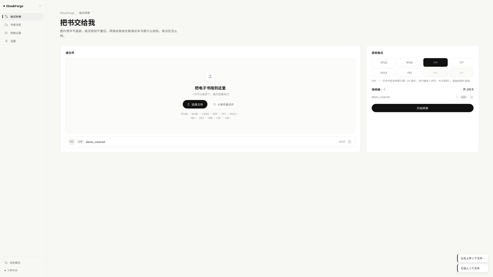
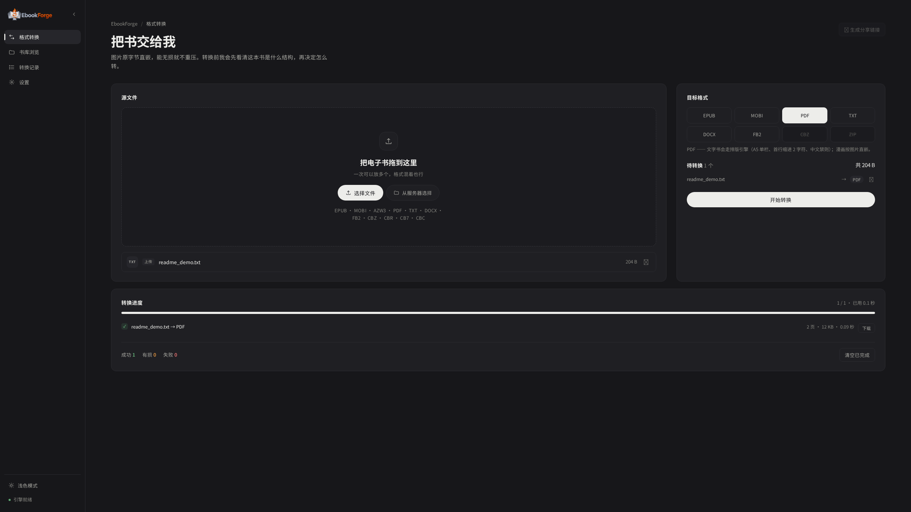

<div align="center">
  

  <br>

  **电子书 / 漫画格式转换，引擎是我自己写的**

  不装 Calibre，不装 poppler，不装 unar —— 镜像 160 MB（Calibre 方案要 1.5 GB）

  [](docker-compose.yml)
  
  
  [](LICENSE)
</div>



---

## 这东西好在哪

### 🪶 轻

市面上的方案基本都套 Calibre，一个 1.5 GB 的庞然大物，还要拉 poppler、unar、p7zip 一堆外部程序。

这个项目的转换部分是从零写的 —— 解 PDF、读 EPUB、拆 MOBI、拼 ZIP，全是 Python 标准库。**没有任何外部二进制**，镜像 160 MB，拉取只要 53 MB，起容器到能转书大概 3 秒。

### 🖼️ 图片转完还是原样

图片是原字节搬进新容器的：不解码、不重采样、不重新压缩。

所以 `CBZ → PDF → CBZ` 这样来回转，图片**逐字节一致**。有命令可以自己验：

```bash
python3 -m bookforge verify 原文件.cbz 转换后.pdf
```

### 📝 文字书是真排版，不是截图

文字书转 PDF 用的是自己写的排版引擎：

- A5 / A4，边距 2cm，单栏
- 章节另起页、页码、首行缩进 2 字符、1.5 倍行距
- 中文按字断行、英文按词断行
- 句号逗号不落行首、开括号不挂行尾
- 行末标点自动压窄，中英文之间留半个空格
- 字体只嵌书里用到的那些字 —— 31 万字的小说，字体只占几十 KB

转出来的 PDF **中文可选中、可复制、可搜索**。

### ⚠️ 有损的情况会明说

有些 PDF 的页面是「图片蒙版」结构（脚本生成的漫画常见），抽出来是反相的黑白图。这种只能逐页拍成图片，**里面的文字会丢**。

工具会转，但结果一定标成琥珀色的「有损」并说明原因，不会混在成功里蒙过去。也可以在设置里关掉这个兜底 —— 关掉后这类文件直接报错。

### 🌐 有网页界面

不用敲命令。四个页面：**格式转换 · 书库浏览 · 转换记录 · 设置**。
侧边栏可收起，深色模式一键切换，能装到手机主屏当 App 用。

---

## 能转什么

| 源格式 | CBZ | ZIP | EPUB | PDF | TXT | FB2 | DOCX | MOBI |
|:---|:-:|:-:|:-:|:-:|:-:|:-:|:-:|:-:|
| **CBZ / ZIP** | ✅ | ✅ | ✅ | ✅ | ➖ | ➖ | ➖ | ➖ |
| **CB7 / CBC**（7z） | ✅ | ✅ | ✅ | ✅ | ➖ | ➖ | ➖ | ➖ |
| **PDF**（图片型） | ✅ | ✅ | ✅ | ✅ | ➖ | ➖ | ➖ | ➖ |
| **EPUB**（漫画） | ✅ | ✅ | ✅ | ✅ | ➖ | ➖ | ➖ | ➖ |
| **MOBI**（漫画） | ✅ | ✅ | ✅ | ✅ | ➖ | ➖ | ➖ | ➖ |
| **TXT** | ➖ | ➖ | ✅ | ✅ | ✅ | ✅ | ✅ | ✅ |
| **FB2** | ➖ | ➖ | ✅ | ✅ | ✅ | ✅ | ✅ | ✅ |
| **DOCX** | ➖ | ➖ | ✅ | ✅ | ✅ | ✅ | ✅ | ✅ |
| **EPUB**（小说） | ➖ | ➖ | ✅ | ✅ | ✅ | ✅ | ✅ | ✅ |
| **MOBI**（小说） | ➖ | ➖ | ✅ | ✅ | ✅ | ✅ | ✅ | ✅ |

💡 **EPUB / PDF / MOBI 是两栖的** —— 里面装的是漫画图片就走漫画那条路，装的是文字就走文字那条路，工具会自己看。所以同一本 EPUB 既能转 CBZ，也能转 TXT。

界面上会按你选的源文件自动置灰不能用的目标格式，鼠标放上去能看到原因。

### 🚫 不支持的

| 格式 | 原因 |
|:---|:---|
| **AZW3 / KF8** | Kindle 的碎片化格式，工作量最大、收益最低 |
| **CBR**（RAR 压缩的漫画） | RAR 算法闭源，没有纯 Python 实现 |
| **DRM 加密书 / 加密 PDF** | 打不开 |
| **脚注 / 多栏 / 图文环绕 / 竖排** | 排版只做到单栏 |

这些会直接报错告诉你原因，**不会悄悄降级，也不会偷偷转成有损**。

---

## 三步跑起来

### 第一步：拉镜像

```bash
docker pull ghcr.io/fenglibo51/ebook-forge:latest
```

### 第二步：存成 `docker-compose.yml`

只改一行 —— 把 `/volume1/Book` 换成你自己的书库路径：

```yaml
services:
  ebook-forge:
    image: ghcr.io/fenglibo51/ebook-forge:latest
    container_name: ebook-forge
    restart: unless-stopped

    ports:
      - "8505:8506"          # 左边 8505 可以改，右边 8506 别动

    volumes:
      - /volume1/Book:/Book:rw    # ← 改成你的书库，必须 rw
      - ebookforge-data:/data     # 记录/设置/上传副本，不用你准备

    environment:
      EBOOKFORGE_DATA: /data
      TZ: Asia/Shanghai
      BOOKFORGE_RENDER_DPI: "200"          # 150 / 200 / 300，界面里也能改
      BOOKFORGE_RENDER_FALLBACK: "true"    # false = 关掉渲染兜底

    security_opt:
      - no-new-privileges:true
    cap_drop:
      - ALL

    healthcheck:
      test: ["CMD", "python3", "-c", "import urllib.request; urllib.request.urlopen('http://127.0.0.1:8506/api/health', timeout=4)"]
      interval: 30s
      timeout: 5s
      start_period: 15s
      retries: 3

volumes:
  ebookforge-data:
```

### 第三步：起容器

```bash
docker compose up -d
```

打开 `http://你的地址:8505` 就能用。**开箱即用，不需要密码。**

> 🔧 想改代码？`git clone` 下来 `docker compose up -d --build` 就行。

### 镜像版本怎么选

```
:latest     最新正式版（当前 1.1.6）
:1.1.6      具体版本号 —— 1.1.5 / 1.1.4 / … / 1.0.0 都留着，出问题能回滚
:dev        开发构建，只推给自己用
```

`latest` 只在打正式 git tag 时才更新，手动触发的构建不会动它。

出问题时换回已知能用的版本：

```bash
docker pull ghcr.io/fenglibo51/ebook-forge:1.1.3
# compose 里 image 改成 :1.1.3，然后 docker compose up -d
```

### 各种上限

```
单文件            1024 MB
单次上传总量       8192 MB
单次文件数          10
单任务文件数        10
排队任务上限        10
```

另外还有「累计配额」挡「同一链接反复传、每次都刚好在单次限额内」这种把磁盘磨满的路子：整个上传目录 2 GB、单条分享链接 512 MB、单会话 128 MB。

超了会明确告诉你用掉多少、上限多少，不是一句「上传失败」。文件到期清理后额度自动恢复。全部能用环境变量调，见 `docker-compose.yml` 里的注释。

### ⚠️ 权限：容器不是 root，书库得让它写得进去

镜像是用 `USER 10000` 跑的，没有 root 权限。这是故意的：万一哪天引擎被恶意文件打穿，攻击者拿到的也是一个连 `/etc` 都改不了的普通用户。

代价是书库目录的属主必须对得上：

```
① 简单粗暴（个人 NAS 够用）
   File Station → 右键书库文件夹 → 属性 → 权限 → 给 your_uid 读写

② 走 ACL（多人共用时用这个）
   sudo synoacltool -add /volume1/Book 'user:10000:allow:rwxpdDaARWc--:fd--'
   sudo synoacltool -get /volume1/Book          # 确认加上了
```

如果转换时报 `Permission denied`，先查属主：`ls -ld /volume1/Book`，看那个数字是不是 10000。

> **别用 `chmod 777` 图省事。** 书库是 NAS 上的长期目录，777 等于全屋设备都能改能删。要给它权限就精确给 uid 10000。

---

## 界面

### 📚 书库浏览

直接在服务器上勾文件批量转，不用先把上百 MB 的文件传一遍再下回来。

格式筛选会看**文件夹内部有没有这个格式** —— 选 MOBI 之后留下的都是真有 MOBI 的目录。


### 📋 转换记录

每次转换都留底，有损的用 `!` 标出来，可以直接下载或重试。


### ⚙️ 设置

排版默认值、渲染精度、输出目录、分享模式、引擎能力一览。改完立刻生效，没有"保存"按钮。


### 🌙 深色模式

侧边栏底部一键切换，没手动选过就跟随系统主题。



---

## 分享给别人用

**默认不需要密码**，适合纯内网自用。

要给朋友临时转格式时，去 **设置 → 分享模式** 打开开关。点一下就行：

- 自动生成一个随机密钥并弹窗显示（**记不记都行**，设置页随时能查回来）
- 后台接口（书库 / 记录 / 设置）开始要求密钥，浏览器输一次记住
- 转换页右上角出现「🔗 生成分享链接」

关掉开关会立刻恢复免密，**并且让所有已发出的分享链接失效**。

### 分享链接长什么样

一条 `你的域名/s/xxxxx` 的地址，24 小时自动失效。

```
拿到链接的人能看到          碰不到
──────────────────────────────────────────────────────────
一个干净的转换页（无侧边栏）   书库、转换记录、设置
上传自己的文件               服务器上的已有文件
选目标格式                   别人的任务和产物
进度和下载                   删任何文件
```

一条链接可以同时给几个人用，按浏览器会话互相隔离。对方上传的文件同样 24 小时后清掉。


### 忘记密钥怎么办

进容器跑一条命令，直接关掉分享模式：

```bash
docker exec ebook-forge python3 -c "
from backend import store
s = store.load_settings(); s['share_enabled'] = False; store.save_settings(s)
print('已关闭分享模式')
"
```

---

## 转换完的文件去哪了

| 情况 | 结果 |
|:---|:---|
| **默认** | 和源文件放同一个目录。`神经榜.mobi` → `神经榜.cbz` |
| **重名** | 自动加 `_1`、`_2`，**绝不覆盖原件**（同格式转换也是，不会写回自己） |
| **自定义目录** | 设置里可以指定统一输出位置，目录不存在会自动创建 |
| **设备上传的文件** | 先存到服务器临时目录，转完给「下载」按钮 |
| **删除源文件** | 只在书库页勾选文件时可选，默认不删，勾了会二次确认；**转换失败时永远不删** |
| **上传副本** | 保留 24 小时后自动清理，设置页可以看占用、可以手动清 |

**你看到的永远是原始文件名。** 磁盘上存的是随机名（防止同名覆盖、防止猜别人的文件），但转换后的输出、下载时的文件名、EPUB 里的书名，全用你上传时的原名：

```
上传  三体.txt                    →  输出  三体.pdf
上传  我的 书 名 v1.2.3.txt        →  输出  我的 书 名 v1.2.3.pdf
上传  ../../etc/passwd.txt        →  输出  passwd.pdf      （路径部分被剥掉）
```

文件名超长会按字节截断（一个汉字算 3 字节，不是按字数 —— 按字数算会超出文件系统的 255 字节上限）。

---

## 有什么限制（说实话）

| 项目 | 说明 |
|:---|:---|
| **内存** | 整本读进内存处理。转一本 100 MB 的漫画，峰值大概吃 200-400 MB |
| **渲染速度** | 蒙版 PDF 走渲染兜底时约 5 秒/页，162 页大约 15 分钟 |
| **进度粒度** | 进度按文件算，不是按页 |
| **OTF 字体体积** | `.otf` 能用了，但不做裁剪 —— 16 MB 的思源黑体会整份嵌进 PDF。`.ttf` 是裁剪的，几 MB 的字体嵌完只剩几 KB |
| **DOCX 嵌图** | PNG / JPEG 原样嵌入。webp / gif 会跳过并在结果里告诉你数量 |
| **AZW3 / CBR** | 不做。KF8 要重写整套解析，CBR 是 RAR，都得引入外部库 |
| **大文件** | 超大合集（几个 GB）内存吃得多。建议给容器设个内存上限，让它 OOM 掉而不是拖垮整台 NAS |

**PDF 渲染兜底的内存**（有些 PDF 没有无损通路，只能逐页拍成图片）：

```
页面像素      尺寸            峰值内存
────────────────────────────────────────────
8.0M        2828×2828        112 MB      ← A4 @300dpi，最常见
50M         7071×7071        631 MB
200M        14142×14142     2347 MB      ← 默认单页上限，长图会摸到这
```

内存小的机器可以把 `BOOKFORGE_MAX_PIXELS` 调下来（比如 `60000000`，峰值降到约 750 MB）。

**整本转换吃多少内存**（实测，CBZ→PDF，800×800 随机噪声 PNG，接近不可压缩）：

```
页数    输入     输出     峰值 RSS   比基线多   增量/输入
──────────────────────────────────────────────────────────
10     18 MB   18 MB     102 MB      72 MB      3.9x
30     55 MB   55 MB     274 MB     172 MB      3.1x
50     92 MB   92 MB     423 MB     148 MB      1.6x
```

增量不是严格线性 —— 10 页到 50 页输入涨 5 倍，增量只涨 2 倍，所以别用「输入 × 固定倍数」估。这些数字是估算参考不是保证：`bytes()` 拷贝、`bytearray` 扩容、zlib 缓冲、分配器碎片都会让真实值偏离。要硬保证就给容器设 `deploy.resources.limits.memory`，让它 OOM 掉。

转换是**单线程串行**的，不会出现「同时转十本内存叠加」，真正吃内存的只有正在跑的那一本。

---

## 技术细节

引擎用「一个中间格式」的思路：所有源文件先读成统一的书模型，再写出目标格式。
所以增加一种新格式只需要写一个读或写，不影响其他任何转换。

```
bookforge/          转换引擎（零依赖，可以单独 import 当库用）
  formats/          CBZ / EPUB / 7z / MOBI / TXT / FB2 / DOCX / PNG
  pdf/              PDF 读写、字体嵌入、排版、渲染兜底
backend/            FastAPI 服务
frontend/           原生 HTML / CSS / JS，无框架无构建
tests/              393 项单元测试
```

当成库用：

```python
from bookforge import convert
r = convert("漫画.cbz", "pdf", dpi=300)
print(r["pages"], r["out"], r["mode"])   # mode: "" 无损 / "render" 有损
```

各格式的内部实现和取舍记录在 [docs/architecture.md](docs/architecture.md)。

---

## 致谢

格式规范来自公开文档：PDF 32000-1、ECMA-376、EPUB 3、MOBI/KF8 reference。

字体使用 [Noto Sans SC](https://fonts.google.com/noto/specimen/Noto+Sans+SC)，SIL Open Font License。
