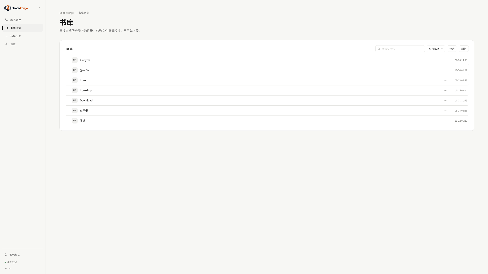
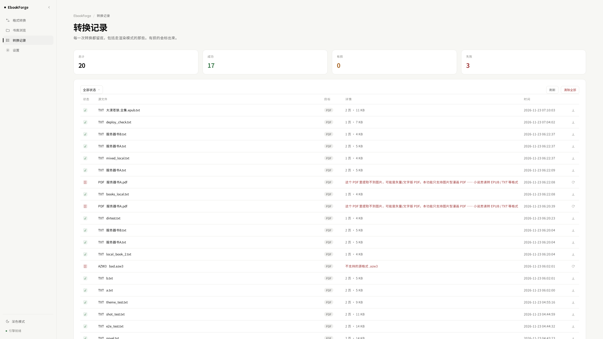
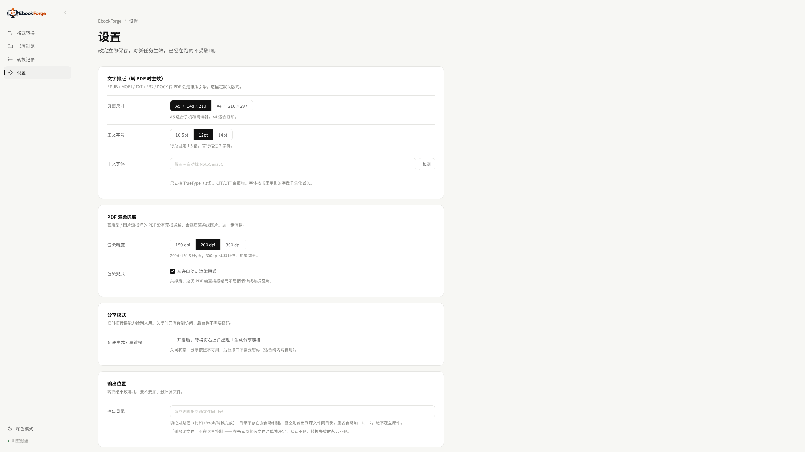
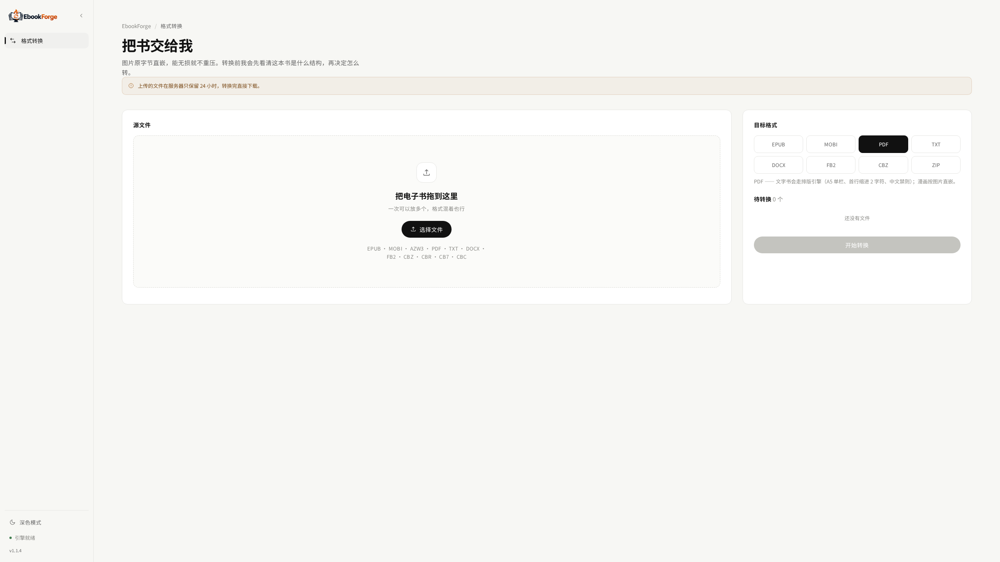

<div align="center">
  

  <br>

  **电子书 / 漫画格式转换，引擎是自己写的**

  不需要 Calibre · 不需要 poppler · 不需要 unar
  镜像 172 MB（Calibre 方案要 1.5 GB）

  [](https://www.python.org/)
  [](docker-compose.yml)
  
</div>


---

## 📖 能转什么

| 源格式 | CBZ | ZIP | EPUB | PDF | TXT | FB2 | DOCX | MOBI |
|:---|:-:|:-:|:-:|:-:|:-:|:-:|:-:|:-:|
| **CBZ / ZIP** | ✅ | ✅ | ✅ | ✅ | ➖ | ➖ | ➖ | ➖ |
| **CB7 / CBC**（7z） | ✅ | ✅ | ✅ | ✅ | ➖ | ➖ | ➖ | ➖ |
| **PDF**（图片型） | ✅ | ✅ | ✅ | ✅ | ➖ | ➖ | ➖ | ➖ |
| **EPUB**（漫画） | ✅ | ✅ | ✅ | ✅ | ➖ | ➖ | ➖ | ➖ |
| **MOBI**（漫画） | ✅ | ✅ | ✅ | ✅ | ➖ | ➖ | ➖ | ➖ |
| **TXT** | ➖ | ➖ | ✅ | ✅ | ✅ | ✅ | ✅ | ✅ |
| **FB2** | ➖ | ➖ | ✅ | ✅ | ✅ | ✅ | ✅ | ✅ |
| **DOCX** | ➖ | ➖ | ✅ | ✅ | ✅ | ✅ | ✅ | ✅ |
| **EPUB**（小说） | ➖ | ➖ | ✅ | ✅ | ✅ | ✅ | ✅ | ✅ |
| **MOBI**（小说） | ➖ | ➖ | ✅ | ✅ | ✅ | ✅ | ✅ | ✅ |

💡 **EPUB / PDF / MOBI 是两栖的** —— 里面装的是漫画图片就走漫画那条路，装的是文字就走文字那条路，
工具会自己看。所以同一本 EPUB 既能转 CBZ，也能转 TXT。

界面上会按你选的源文件自动置灰不能用的目标格式，鼠标放上去能看到原因。

### 🚫 不支持的

| 格式 | 原因 |
|:---|:---|
| **AZW3 / KF8** | Kindle 的碎片化格式，工作量最大、收益最低 |
| **CBR**（RAR） | RAR5 算法闭源，没有纯 Python 实现 |
| **DRM 加密书 / 加密 PDF** | 打不开 |
| **脚注 / 多栏 / 图文环绕 / 竖排** | 排版只做到单栏 |

这些会直接报错告诉你原因，**不会悄悄降级，也不会偷偷转成有损**。

---

## ✨ 转换质量

### 🖼️ 图片：能无损就绝不重压

图片原样搬进新容器，不解码、不重采样、不重新压缩。

所以 `CBZ → PDF → CBZ` 这样来回转，图片逐字节一致 —— 有校验命令可以自己验：

```bash
python3 -m bookforge verify 原文件.cbz 转换后.pdf
```

### 📝 文字：真排版，不是截图

文字书转 PDF 用的是自己写的排版引擎：

- A5 / A4，边距 2cm，单栏
- 章节另起页、页码、首行缩进 2 字符、1.5 倍行距
- 中文按字断行、英文按词断行
- 句号逗号不落行首、开括号不挂行尾
- 行末标点自动压窄，中英文之间留半个空格
- 字体只嵌书里用到的那些字（31 万字的小说，字体只占几十 KB）

转出来的 PDF 中文可选中、可复制、可搜索。

### ⚠️ 有损的情况会明说

有些 PDF 的页面是「图片蒙版」结构（脚本生成的漫画常见），抽出来是反相的黑白图。
这种只能逐页拍成图片，**里面的文字会丢**。

工具会转，但结果一定标成琥珀色的「有损」并说明原因，不会混在成功里蒙过去。
也可以在设置里关掉这个兜底 —— 关掉后这类文件直接报错。

---

## 🚀 快速开始

### Docker（推荐）

```bash
git clone https://github.com/fenglibo51/ebook-forge.git
cd ebook-forge
docker compose up -d --build
```

打开 `http://<你的地址>:8505` 就能用。**开箱即用，不需要密码。**

**唯一要改的是书库路径。** 仓库里的 `docker-compose.yml` 就是下面这份：

```yaml
services:
  ebook-forge:
    build: .
    image: ebook-forge:latest
    container_name: ebook-forge
    restart: unless-stopped

    ports:
      - "8505:8506"          # 左=NAS 端口（反代指它）右=容器内，别动右边

    volumes:
      - /volume1/Book:/Book:rw    # ← 改成你的书库路径，必须 rw
      - ebookforge-data:/data     # 记录/设置/上传副本（命名卷，不用你准备）

    environment:
      EBOOKFORGE_DATA: /data
      EBOOKFORGE_ADMIN_TOKEN: ${EBOOKFORGE_ADMIN_TOKEN:-}   # 留空 = 不开后台认证
      TZ: Asia/Shanghai
      BOOKFORGE_RENDER_DPI: "200"          # 150 / 200 / 300，界面里也能改
      BOOKFORGE_RENDER_FALLBACK: "true"    # false = 关掉渲染兜底，这类 PDF 直接报错
      EBOOKFORGE_UPLOAD_TTL: "86400"       # 上传副本保留 24 小时

    security_opt:
      - no-new-privileges:true             # 禁止 setuid 提权
    cap_drop:
      - ALL                                # 纯 HTTP 服务不需要任何 capability

    healthcheck:
      test: ["CMD", "python3", "-c", "import urllib.request; urllib.request.urlopen('http://127.0.0.1:8506/api/health', timeout=4)"]
      interval: 30s
      timeout: 5s
      start_period: 15s
      retries: 3

volumes:
  ebookforge-data:
```

> ⚠️ `:/Book` 后面必须是 `rw`（可写）—— 转换结果默认写回源文件所在的目录，只读会失败。

不想用 git clone 也行，把上面这份存成 `docker-compose.yml`，
再把仓库里的 `Dockerfile`、`bookforge/`、`backend/`、`frontend/`、`assets/`、`requirements.txt` 和它放同一层，
`docker compose up -d --build` 一样能起来。

### ⚠️ 权限：容器不是 root，挂载目录得让它写得进去

镜像里是 `USER 10000:10000` 运行的，**没有 root 权限**。这是故意的：万一哪天转换引擎被恶意文件打穿，攻击者拿到的也是一个连 `/etc` 都改不了的普通用户。

代价是宿主机目录的属主必须对得上。

**用命名卷（默认）** —— 什么都不用管。Docker 首次创建卷时会继承镜像里 `/data` 的属主（10000:10000）。

**用 bind mount（想直接看 data 里的 json）** —— 必须先手动建目录并改属主，否则容器起不来：

```bash
mkdir -p ./data
sudo chown -R 10000:10000 ./data      # 群晖上去掉 sudo
```

然后用 `docker-compose.override.yml` 覆盖（这个文件不进 git）：

```yaml
# docker-compose.override.yml
services:
  ebook-forge:
    volumes:
      - /volume1/Book:/Book:rw
      - ./data:/data
```

**书库目录（`/Book`）也要能让 uid 10000 写。** 转换结果默认写在源文件旁边，所以整个书库路径对它是可写的。群晖上两种做法：

```
① 简单粗暴（个人 NAS 够用）
   File Station → 右键书库文件夹 → 属性 → 权限 → 给 your_uid 读写

② 走 ACL（多人共用时用这个）
   sudo synoacltool -add /volume1/Book 'user:10000:allow:rwxpdDaARWc--:fd--'
   sudo synoacltool -get /volume1/Book          # 确认加上了
```

> 如果转换时报 `Permission denied`，先查属主：`ls -ld /volume1/Book`，看那个数字是不是 10000。

**改完还是不行的三种情况**（都真遇到过）：

```
① 群晖 ACL 盖过 chown
   ls -ld 显示 10000:10000 了，但容器里还是写不进去 —— 说明共享文件夹开着
   Windows ACL，ACL 优先于属主。用 synoacltool -get 看有没有显式 deny，
   或者干脆按上面 ② 的方式给 10000 单独加一条 allow。

② 只改了书库，忘了 data 目录
   转换能跑但一上传就 500 —— /data/uploads 建不出来。两个目录都要给。

③ 自己改过 Dockerfile（比如加了新文件）
   COPY 会保留源文件权限，如果源文件是 600 root，非 root 的进程读不到，
   表现是「容器 healthy 但功能全崩」。加一句 RUN chmod -R a+rX /app 兜住。
```

> 健康检查 200 **不代表功能正常**。字体文件权限不对时，容器照样 healthy，
> 但一转文字书就 `PermissionError`。验收要真上传一本书转一次。

### 不想给写权限？

设置里指定一个「统一输出目录」，只把那个目录挂成 rw，书库挂成 `ro` 也行 —— 代价是转换结果不再落在源文件旁边，得去输出目录里找。

### 不用 Docker

```bash
pip install -r requirements.txt
python3 -m backend.main          # → http://localhost:8506
```

### 命令行

```bash
python3 -m bookforge convert 漫画.cbz pdf            # 输出在同目录
python3 -m bookforge convert 小说.epub pdf -o 输出.pdf
python3 -m bookforge convert 漫画.cbz pdf --fit page --page-size a5
python3 -m bookforge verify 原文件.cbz 转换后.pdf      # 逐张校验无损
```

当成库用：

```python
from bookforge import convert
r = convert("漫画.cbz", "pdf", dpi=300)
print(r["pages"], r["out"], r["mode"])   # mode: "" 无损 / "render" 有损
```

---

## 🖥️ 界面

四个页面：**格式转换 · 书库浏览 · 转换记录 · 设置**。侧边栏可收起，深色模式一键切换。

### 📚 书库浏览

直接在服务器上勾文件批量转，不用先把上百 MB 的文件传一遍再下回来。

格式筛选会看**文件夹内部有没有这个格式** —— 选 MOBI 之后留下的都是真有 MOBI 的目录。



### 📋 转换记录

每次转换都留底，有损的用 `!` 标出来，可以直接下载或重试。



### ⚙️ 设置

排版默认值、渲染精度、输出目录、分享模式、引擎能力一览。



### 🌙 深色模式

侧边栏底部一键切换，没手动选过就跟随系统主题。


---

## 🔐 访问控制

**开箱即用不需要密码。** 装好直接访问，四个页面都能用 —— 适合纯内网自用。

要给别人临时转格式时，去 **设置 → 分享模式** 打开开关。点一下就行：

- 自动生成一个随机密钥并弹窗显示（**记不记都行**，设置页随时能查回来）
- 后台接口（书库 / 记录 / 设置）开始要求密钥，浏览器输一次记住
- 转换页右上角出现「🔗 生成分享链接」

关掉开关会立刻恢复免密，**并且让所有已发出的分享链接失效**。

### 分享链接长什么样

一条 `你的域名/s/xxxxx` 的地址，24 小时自动失效。

```
拿到链接的人能看到          碰不到
──────────────────────────────────────────────────────────
一个干净的转换页（无侧边栏）   书库、转换记录、设置
上传自己的文件               服务器上的已有文件
选目标格式                   别人的任务和产物
进度和下载                   删任何文件
```

一条链接可以同时给几个人用，按浏览器会话互相隔离。对方上传的文件同样 24 小时后清掉。



### 忘记密钥怎么办

进容器跑一条命令，直接关掉分享模式：

```bash
docker exec ebook-forge python3 -c "
from backend import store
s = store.load_settings(); s['share_enabled'] = False; store.save_settings(s)
print('已关闭分享模式')
"
```

### 资源配额

```
单文件        1024 MB     EBOOKFORGE_MAX_FILE_MB
单次上传总量   8192 MB     EBOOKFORGE_MAX_UPLOAD_MB
单次文件数      10         EBOOKFORGE_MAX_FILES_UPLOAD
单任务文件数    10         EBOOKFORGE_MAX_FILES_TASK
排队任务上限    10         EBOOKFORGE_MAX_QUEUE
```

压缩包在解压前会按头部声明的大小检查（总解压量 / 单条目 / 条目数），炸弹包直接拒绝。

**解压限额单独一组**（`bookforge/formats/limits.py`，CBZ / EPUB / DOCX 共用）：

```
单条目        256 MB      BOOKFORGE_MAX_ENTRY_MB
整包解压总量   4096 MB     BOOKFORGE_MAX_TOTAL_MB
条目数        5000        BOOKFORGE_MAX_ENTRIES
```

7z 除了看头部声明，解压完还会按**实际字节数**再卡一次 —— 声明字段是可以撒谎的（改几个字节就能把几十 GB 说成几十 KB）。

**上传副本的清理**（三处，都是自动的）：

```
启动时       清一次过期的
每小时       定时清一次（EBOOKFORGE_CACHE_INTERVAL 调间隔，设 0 关掉）
建任务时     顺手清一次
```

设置页能看到当前占用、也能手动清。

---

## 📁 转换完的文件去哪了

| 情况 | 结果 |
|:---|:---|
| **默认** | 和源文件放同一个目录。`神经榜.mobi` → `神经榜.cbz` |
| **重名** | 自动加 `_1`、`_2`，**绝不覆盖原件**（同格式转换也是，不会写回自己） |
| **自定义目录** | 设置里可以指定统一输出位置，目录不存在会自动创建 |
| **设备上传的文件** | 先存到服务器临时目录，转完给「下载」按钮 |
| **删除源文件** | 只在书库页勾选文件时可选，默认不删，勾了会二次确认；**转换失败时永远不删** |
| **上传副本** | 保留 24 小时后自动清理，设置页可以看占用、可以手动清 |

### 📥 上传的文件存哪

不是 `/tmp`。存在数据目录下的 `uploads/`：

```
位置        容器内 /data/uploads/    挂载出去就是 <你的数据目录>/uploads/
文件名      随机 file_id，例如 N3n2m_3mIqR.pdf  —— 不是原始文件名
索引        <数据目录>/uploads.json   file_id → 原始文件名 / 大小 / 上传来源
权限        700，只有容器自己的用户（uid 10000）能读
清理        满 24 小时自动删；每次建转换任务时顺手清一次
```

**为什么不用 /tmp**：容器重启 `/tmp` 就没了，用户传到一半刷新页面文件就丢了；
而且 `/tmp` 经常挂成 tmpfs，占的是内存不是磁盘。放数据目录里才能算 TTL、
才能在设置页看到「缓存占用」并手动清。

**为什么用随机名**：① 归属校验 —— 只有服务端知道这个 file_id 是谁传的，
访客传不到别人的；② 同名并发上传不会互相覆盖。原始文件名只作为展示存进索引。

分享链接传进来的文件和后台传的文件**走同一条路径、同一套清理规则**，
区别只是多了一个归属绑定（file_id + 分享 token + 浏览器会话三者对上才让用）。

---

## ⚠️ 已知限制

| 项目 | 说明 |
|:---|:---|
| **内存** | 整本读进内存处理。单本几个 GB 的合集会吃很多内存 |
| **渲染速度** | 蒙版 PDF 走渲染兜底时约 5 秒/页，162 页大约 15 分钟 |
| **进度粒度** | 进度按文件算，不是按页 |
| **CFF 字体体积** | `.otf`（CFF 轮廓）能用了，但不做子集化 —— 16MB 的思源黑体会整份嵌进 PDF。`.ttf` 是子集化的，几 MB 的字体嵌完只剩几 KB |
| **DOCX 嵌图格式** | PNG / JPEG 原字节嵌入。webp / gif 会跳过并在结果里告诉你数量（DOCX 里这两个格式兼容性太差） |
| **AZW3 / CBR** | 不做。KF8 要重写整套解析，CBR 是 RAR5，都得引入外部库 |
| **解压上限** | 单条目 256MB / 整包 4GB / 5000 个条目，防解压炸弹。大画集要调 `BOOKFORGE_MAX_ENTRY_MB` |

---

## 🛠️ 技术说明

引擎用「一个中间格式」的思路：所有源格式先读成统一的书模型，再从书模型写出目标格式。
所以增加一种新格式，只需要写一个读或写，不影响其他任何转换。

```text
bookforge/          转换引擎（零依赖，可以单独 import 当库用）
  formats/          CBZ / EPUB / 7z / MOBI / TXT / FB2 / DOCX / PNG
  pdf/              PDF 读写、字体嵌入、排版、渲染兜底
backend/            FastAPI 服务
frontend/           原生 HTML / CSS / JS，无框架无构建
tests/              134 项单元测试（含恶意压缩包、跨会话越权、PWA 契约）
```

```bash
python3 -m unittest discover -s tests
```

各格式的内部实现笔记和取舍记录在 [docs/architecture.md](docs/architecture.md)。

---

## 🙏 致谢

格式规范来自公开文档：PDF 32000-1、ECMA-376、EPUB 3、MOBI/KF8 reference。

字体使用 [Noto Sans SC](https://fonts.google.com/noto/specimen/Noto+Sans+SC)，SIL Open Font License。
