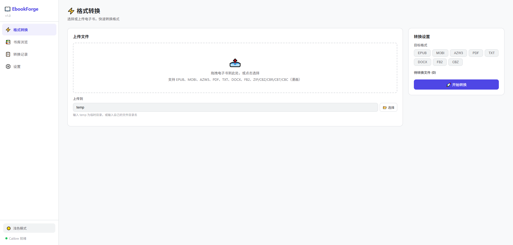
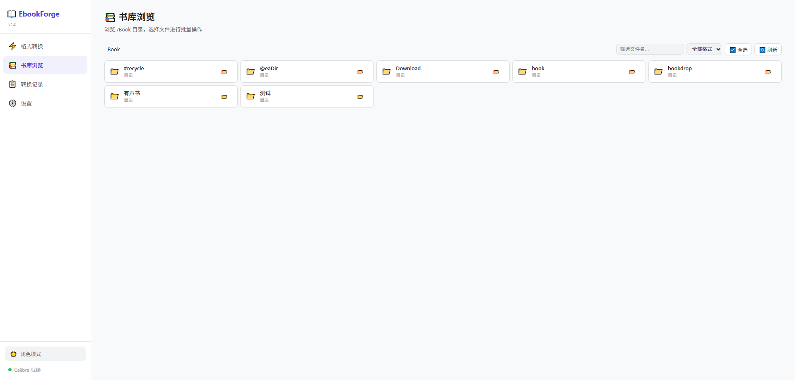
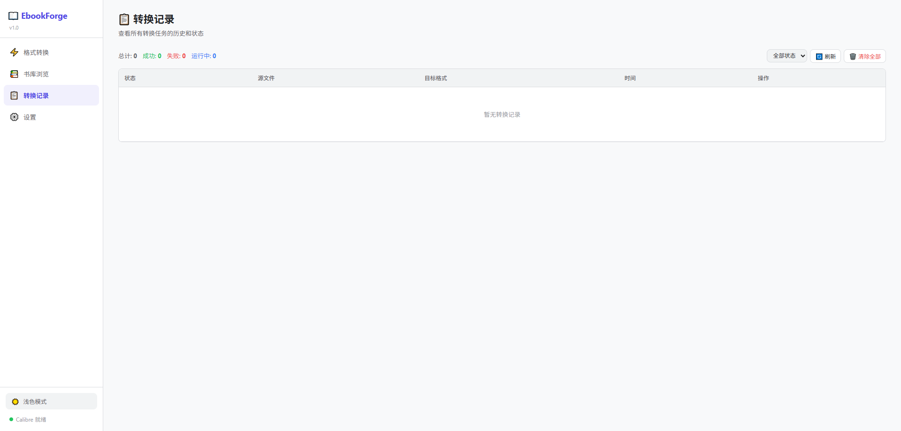
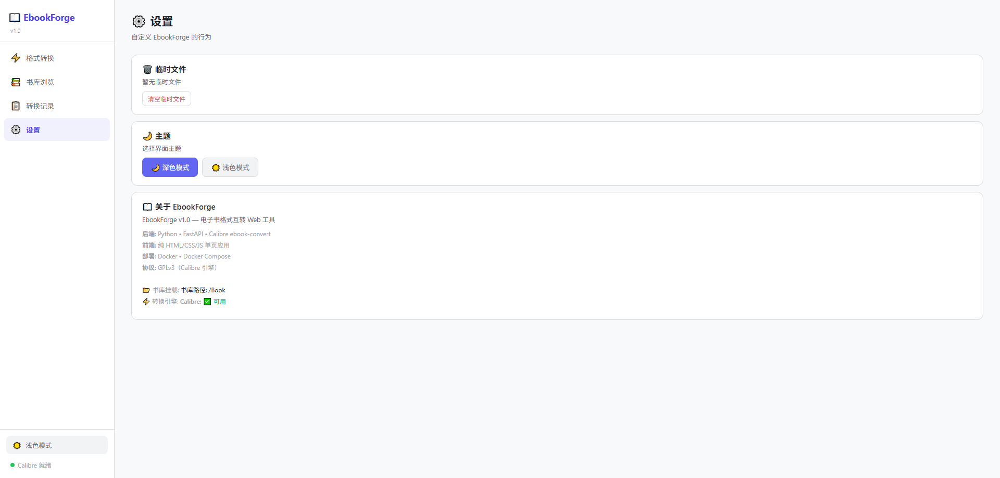

# EbookForge

电子书格式互转 Web 工具。基于 Calibre `ebook-convert` 引擎，支持常见电子书格式互转。

## 功能

- **格式转换** — EPUB、MOBI、AZW3、PDF、TXT、DOCX、FB2 互转


- **上传转换** — 上传文件 → 选格式 → 转换 → 下载
- **书库管理** — 浏览本地书库目录，勾选批量转换


- **实时进度** — 进度条 + 日志，不刷屏
- **历史记录** — 自动持久化，刷新不丢失（最多保留 500 条）
- **临时文件管理** — 设置页查看大小，一键清理





## 技术栈

| 层 | 选型 |
|------|------|
| 后端 | Python • FastAPI |
| 转换引擎 | Calibre ebook-convert |
| 前端 | 纯 HTML/CSS/JS 单页应用 |
| 部署 | Docker • Docker Compose |
| 协议 | GPLv3（Calibre 引擎） |

## 快速开始

```yaml
# docker-compose.yaml
services:
  ebook-forge:
    image: fenglibo51/ebook-forge:latest
    container_name: ebook-forge
    ports:
      - "8505:8000"
    volumes:
      - /path/to/your/books:/Book:rw
      - ./temp:/temp:rw
    environment:
      - BOOK_PATH=/Book
      - TEMP_DIR=/temp
    restart: unless-stopped
```

或者从源码构建：

```bash
git clone https://github.com/fenglibo51/ebook-forge.git
cd ebook-forge
docker compose up -d --build
```

然后打开 `http://localhost:8505`。

## Docker Compose

```yaml
services:
  ebook-forge:
    build: .
    container_name: ebook-forge
    ports:
      - "8505:8000"
    volumes:
      - /path/to/your/books:/Book:rw
      - ./temp:/temp:rw
      - ebook-forge-data:/data
    environment:
      - BOOK_PATH=/Book
      - TEMP_DIR=/temp
    restart: unless-stopped

volumes:
  ebook-forge-data:
```

## 数据持久化

- **转换历史** — 保存在 Docker named volume `ebook-forge-data` 中
- **临时文件** — 映射到宿主机的 `./temp` 目录
- **书库文件** — 映射你的电子书目录到容器 `/Book`

## 开发

```bash
# 宿主机直接运行（需要本地安装 Calibre）
pip install -r backend/requirements.txt
uvicorn backend.main:app --reload --port 8000
```

## License

GPLv3 — 因为使用了 Calibre 引擎。
